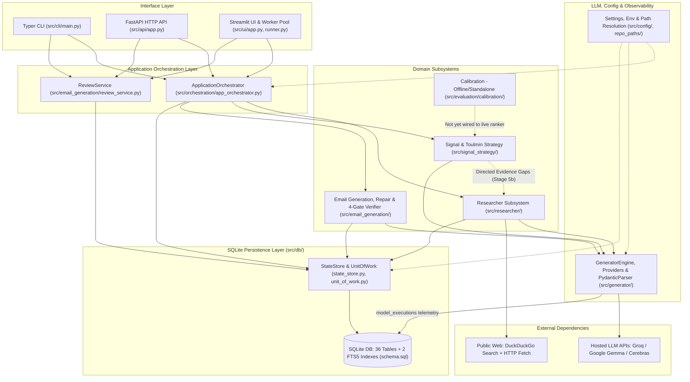
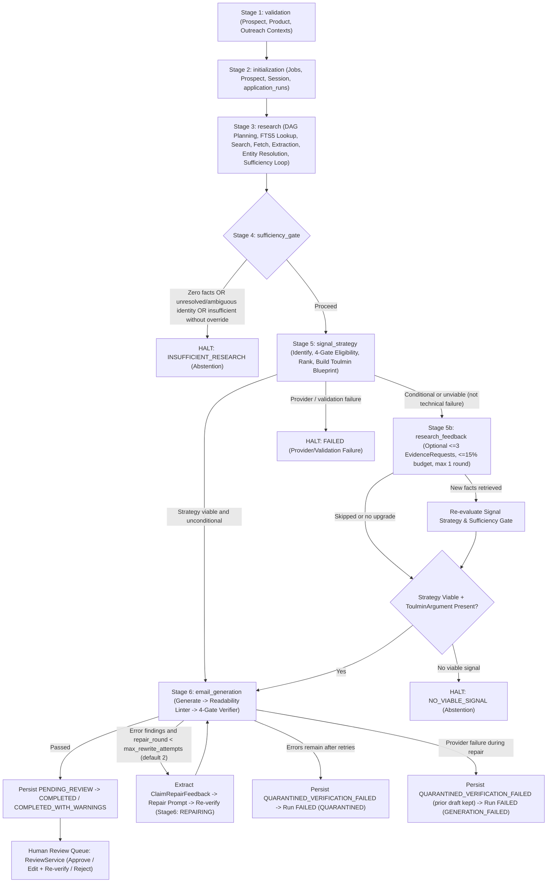
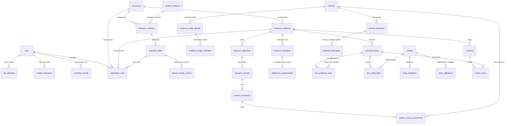

# Open Inquiry

Open Inquiry is an evidence-grounded B2B prospect research and outreach generation system. Given a target prospect, company context, a structured **Product Capability Contract**, and an outreach configuration, it autonomously plans and executes web research, resolves person and organization identities, extracts quote-verified facts into SQLite, synthesizes a Toulmin-structured commercial strategy, and generates concise outreach drafts guarded by a deterministic 4-gate claim verification engine, an automated bounded repair loop, and mandatory human review before delivery.

> **Safety boundary:** Open Inquiry never auto-sends emails. Every draft is verified against approved SQLite evidence and product capability bounds, automatically repaired within bounded retries if errors are detected, quarantined if still failing, and held in human review (`pending_review` or `quarantined_verification_failed`) until an operator explicitly approves, edits, or rejects it.

---

## Table of Contents

1. [Project Overview](#1-project-overview)
2. [System Architecture](#2-system-architecture)
3. [End-to-End Workflow](#3-end-to-end-workflow)
4. [Core Subsystems](#4-core-subsystems)
5. [Data Architecture](#5-data-architecture)
6. [LLM and Provider Architecture](#6-llm-and-provider-architecture)
7. [Epistemic Safety and Verification](#7-epistemic-safety-and-verification)
8. [Interfaces](#8-interfaces)
9. [Project Structure](#9-project-structure)
10. [Development and Execution](#10-development-and-execution)
11. [Current Limitations](#11-current-limitations)

---

## 1. Project Overview

### Purpose and Problem Solved

Standard LLM-based sales outreach generators frequently hallucinate company pain points, treat syndicated press releases as independent corroboration, attach facts to the wrong namesake person or company, overstate unverified product outcomes, and blur inference with fact.

Open Inquiry separates **neutral evidence gathering**, **identity disambiguation**, **commercial signal gating**, **argument synthesis**, and **post-generation claim verification** into discrete, persisted stages so that every claim in an outbound draft is traceable to verbatim source passages and whitelisted product capabilities.

### Core Capabilities

- **Context & Closed-World Product Contract (`ProductContract`):** Represents discrete `CapabilityNode` definitions, target personas, prerequisites, hard exclusions, and whitelisted proof points, with deterministic compatibility checking (`VERIFIED_COMPATIBLE`, `CONDITIONAL_ON_UNKNOWN`, `INCOMPATIBLE`).
- **Epistemic Question DAG & Value-of-Information (VoI) Scheduling:** Translates research objectives into hypothesis-blind questions, models identity dependencies, classifies observability (`PUBLICLY_OBSERVABLE`, `CONDITIONALLY_OBSERVABLE`, `PRIVATE_OR_NONPUBLIC`), and budgets web queries via deterministic VoI scoring.
- **Quote-Verified Fact Extraction & Molecular Consolidation:** Fetches HTML pages (`httpx` + `trafilatura`), verifies extracted quotes deterministically against raw page text (`ExcerptValidator`), clusters syndicated copies via SHA-256 + 5-gram MinHash/LSH + Jaccard (`SyndicationDetector`), decomposes facts into atomic/molecular propositions with bitemporal metadata, and flags conflicts.
- **Historical Lexical Retrieval (SQLite FTS5):** Queries prior indexed `source_snapshots` and `evidence_passages` before issuing external searches (`HistoricalRetrievalService`).
- **Explainable Margin-Based Entity Resolution:** Scores candidate persons and organizations across identifiers, domains, roles, and affiliations (`ProbabilisticEntityResolver`), distinguishing `MATCH`, `NO_MATCH`, `AMBIGUOUS`, and `UNRESOLVED` and halting downstream stages on unresolved or ambiguous targets.
- **Non-Compensatory Signal Gating & Toulmin Strategy Synthesis:** Validates candidate signals through four hard gates (Identity, Evidence, Product Compatibility, Persona) and constructs a structured `ToulminArgument` (`Grounds`, `Warrant`, `Backing`, `Qualifier`, `Claim`, `Rebuttal`) prior to email drafting.
- **Stage 6 Generate–Verify–Repair Loop & Human Review:** Generates concise emails, runs readability linting and a 4-gate `ClaimVerifierService`, executes up to two structured claim-level repair passes without inventing facts or relaxing rules, quarantines persistent failures, and records immutable audit events for human review (`APPROVED`, `REJECTED`, `EDITED`).

### Architectural Principles

1. **Deterministic Guardrails Around Bounded LLM Tasks:** LLMs propose plans, extract facts, identify candidate signals, draft blueprints/emails, and score semantic entailment; deterministic Python code enforces substring quotes, schema parsing, entity margins, budget bounds, compatibility rules, modality checks, capability bounds, and SQLite persistence.
2. **Short Transaction Discipline:** `UnitOfWork` (`BEGIN IMMEDIATE`) wraps database mutations in brief, atomic SQLite transactions and is **never held open across network or LLM I/O**.
3. **Abstention Is Distinct from Technical Failure:** Missing public facts, ambiguous identities, or absent commercial catalysts terminate as explicit **abstentions** (`INSUFFICIENT_RESEARCH`, `NO_VIABLE_SIGNAL`), whereas provider errors, schema parsing errors, or unresolved draft verification terminate as **failures** (`FAILED`, `QUARANTINED`, `GENERATION_FAILED`).
4. **Provenance by Construction:** Domain outputs carry `OutputProvenance` (`MODEL`, `DETERMINISTIC_RULE`, `HEURISTIC_FALLBACK`, `MANUAL_INPUT`) and persist foreign keys back to `source_snapshots`, `evidence_passages`, `canonical_facts`, and `model_executions`.

---

## 2. System Architecture

Open Inquiry is organized as a layered modular monolith backed by a single SQLite database. The CLI, FastAPI server, and Streamlit UI all delegate pipeline execution to `ApplicationOrchestrator` and draft review operations to `ReviewService`.



### Layer Responsibilities and Data Flow

- **Interface Layer ([`src/cli/`](src/cli/), [`src/api/`](src/api/), [`src/ui/`](src/ui/)):** Accepts `ProspectContext`, `ProductContext`/`ProductContract`, and `OutreachContext`; renders run snapshots, research artifacts, and repair histories; exposes review decisions (`approve`, `reject`, `edit`). No interface imports internal researcher subcomponents directly to bypass `ApplicationOrchestrator`.
- **Application Orchestration ([`src/orchestration/`](src/orchestration/)):** Coordinates the multi-stage pipeline, propagates observability `ContextVar` values (`active_run_id`, `active_job_id`, `active_stage_name`), enforces global budget tracking (`GlobalResearchBudget`), halts cleanly on abstentions or circuit-breakers, and atomically records per-stage timelines (`StageExecutionRecord`) in `application_runs`.
- **Domain Subsystems:**
  - [`src/researcher/`](src/researcher/) consumes input contexts and produces an immutable `ResearchPackage` (sources, verbatim passages, resolved entities, canonical/molecular facts, conflicts, and sufficiency assessment).
  - [`src/signal_strategy/`](src/signal_strategy/) consumes `ResearchPackage` + contexts and returns a `StrategyResult` containing candidate signals, 4-gate eligibility assessments, scores, `OutreachStrategy`, and `ToulminArgument`—plus optional hypothesis-blind `EvidenceRequest` items when conditional gaps exist.
  - [`src/email_generation/`](src/email_generation/) consumes an approved `OutreachStrategy`, `ResearchPackage`, and `ProductContract` to run draft synthesis, readability linting, 4-gate verification, and bounded repair before persisting a `VerifiedOutreachDraft`.
- **Infrastructure & Persistence ([`src/generator/`](src/generator/), [`src/db/`](src/db/), [`src/config/`](src/config/)):** `GeneratorEngine` abstracts prompt rendering, provider invocation, rate pacing, JSON extraction/validation, and `model_executions` logging. `StateStore` and `UnitOfWork` isolate all SQLite reads/writes behind 9 repository classes (`10` attributes on `UnitOfWork`) and WAL-mode connections with `PRAGMA foreign_keys = ON`.

---

## 3. End-to-End Workflow

`ApplicationOrchestrator.run()` ([`src/orchestration/app_orchestrator.py`](src/orchestration/app_orchestrator.py)) drives every inquiry through numbered application stages (`StageIdentifier`), persisting stage transitions into `application_runs.stage_statuses_json` as each stage begins and finishes.



### Stage-by-Stage Breakdown

| Stage | Enum / Identifier | Primary Inputs | Outputs & Persistence | Failure / Abstention Behavior |
| :--- | :--- | :--- | :--- | :--- |
| **1. Input Validation** | `validation` | `ProspectContext`, `ProductContext`, `OutreachContext` | Validates required fields, `ProductContract` integrity, non-empty names/companies | Stops immediately on Pydantic/contract validation error (`FAILED`) |
| **2. Session Initialization** | `initialization` | Context models, `run_id`, optional `project_id` | Inserts rows into `jobs`, `job_attempts`, `prospects`, `product_versions`, `outreach_contexts`, `research_sessions`, `application_runs` | Prevents orphaned runs; supports pre-created `pending` UI runs |
| **3. Autonomous Research** | `research` | Target prospect/company, budget (`total_research_budget`, default `20`), `max_iterations` | Executes planning, Epistemic DAG, FTS5 historical lookup, DuckDuckGo search, page fetch, excerpt-validated extraction, entity resolution, and sufficiency evaluation; returns `ResearchPackage` | Missing results degrade cleanly; provider/fatal exceptions finalize run as `FAILED` |
| **4. Epistemic Sufficiency Gate** | `sufficiency_gate` | `ResearchPackage`, `allow_insufficient_research` flag | Gate decision (`proceed` or `halt`) recorded in stage timeline | Zero facts, unresolved/ambiguous `company_entity` or `prospect_entity`, or `is_sufficient=False` (unless overridden) triggers `ABSTAINED` -> `RunStatus.INSUFFICIENT_RESEARCH` and skips downstream stages |
| **5. Signal Strategy Synthesis** | `signal_strategy` | `ResearchPackage`, `ProspectContext`, `ProductContext`, `OutreachContext` | `StrategyResult`: candidate signals, `SignalEligibility`, `RankedSignal` list, `OutreachStrategy`, `ToulminArgument` | Distinguishes `ABSTAINED` (`no_qualifying_signals`, `no_viable_signal`) from technical `FAILED` (`provider_failure`, `validation_failure`) |
| **5b. Bounded Evidence Feedback** | `research_feedback` | Conditional or non-viable `StrategyResult`, `ResearchPackage`, remaining budget | Up to 3 hypothesis-blind `EvidenceRequest` queries executed by `EvidenceRequestExecutor`; optional Stage 5 re-run | Runs at most 1 round capped at 15% of total budget (`EvidenceFeedbackBudget`); skipped if strategy is unconditional, Stage 5 had a technical failure, budget is exhausted, or no actionable gaps exist |
| **6. Email Generation, Repair & Verification** | `email_generation` | Viable `OutreachStrategy` + `ToulminArgument`, `ResearchPackage`, `ProductContract` | `VerifiedOutreachDraft` persisted to `outreach_drafts` (`subject`, `body`, `claim_verifications`, `quality_evaluation` including `original_draft` and `repair_history`) | Passes cleanly -> `PENDING_REVIEW` (`Stage6DraftStatus.VERIFIED`). Unresolved errors after up to 2 repairs -> `QUARANTINED_VERIFICATION_FAILED` (`QUARANTINED`, `RunStatus.FAILED`). Provider crash mid-repair -> `QUARANTINED_VERIFICATION_FAILED` preserving prior candidate (`GENERATION_FAILED`, `RunStatus.FAILED`) |
| **Run Finalization** | `_finalize_run()` / `finalization` | Final status, stage timeline, warnings, errors | Atomically updates `application_runs` (`status`, `draft_id`, `strategy_result_json`, `feedback_round_json`, `stage_statuses_json`) and `jobs` | Note: `StageIdentifier.FINALIZATION` exists in the enum, while persistence runs via `ApplicationOrchestrator._finalize_run()` |

### Verification and Human Approval Checkpoints

1. **Research Ingestion:** Verbatim excerpts must match normalized page text byte-for-byte before becoming `EvidenceRecord` entries.
2. **Pre-Strategy Gate:** Identity ambiguity (`prospect_entity` and `company_entity`) and zero-fact / insufficient sessions halt before strategy synthesis.
3. **Strategy Gate:** Non-compensatory `SignalEligibilityEvaluator` + `ProductContract.evaluate_compatibility()` block incompatible pitches before email generation.
4. **Stage 6 Automated Gate:** `ReadabilityLinter` + 4-gate `ClaimVerifierService` inspect every generated and repaired candidate.
5. **Human Review (`ReviewService`):** Only drafts passing verification enter `pending_review`; operators inspect provenance, edit drafts (triggering full re-verification), or issue `APPROVED` / `REJECTED` decisions recorded in append-only `human_review_events`.

---

## 4. Core Subsystems

### 4.1 Application Orchestration ([`src/orchestration/`](src/orchestration/))

- **Files:** [`app_orchestrator.py`](src/orchestration/app_orchestrator.py), [`models.py`](src/orchestration/models.py), [`__init__.py`](src/orchestration/__init__.py)
- **Responsibilities:** Coordinates pipeline execution across Stages 1–6, manages `ApplicationRunSnapshot` and `RunResult` serialization, performs `create_pending_run()`, enforces interrupted-run recovery (`reconcile_interrupted_runs()`), and exposes read APIs (`get_run()`, `get_run_stages()`, `get_research_inspection()`, `get_strategy_explainability()`).
- **Interactions:** Instantiates and wires `HistoricalRetrievalService`, `Researcher`, `EvidenceRequestExecutor`, `SignalStrategyService`, and `EmailGenerationService`.

### 4.2 Context, Product Capability Contract & Provenance ([`src/context/`](src/context/), [`src/common/`](src/common/))

- **Files:** [`src/context/models.py`](src/context/models.py), [`src/common/provenance.py`](src/common/provenance.py)
- **Responsibilities:** Defines immutable input and boundary models (`ProspectContext`, `ProductContext`, `OutreachContext`, `ProductContract`, `CapabilityNode`, `ProductConstraint`). Implements deterministic `ProductContract.evaluate_compatibility()`, rejecting contradictions where prerequisites collide with hard exclusions and distinguishing `VERIFIED_COMPATIBLE`, `CONDITIONAL_ON_UNKNOWN` (e.g., undeclared capabilities when `is_exhaustive=False`), and `INCOMPATIBLE`.

### 4.3 Research Orchestration, Planning & Epistemic DAG ([`src/researcher/`](src/researcher/))

- **Planning ([`src/researcher/planning/`](src/researcher/planning/)):** `ResearchPlanner` calls `GROQ_LARGE` with `PydanticParser(ResearchPlan)` to generate 2–4 neutral objectives (`identity_resolution`, `neutral_discovery`, optional `product_oriented`) within bounded query budgets.
- **Epistemic Question DAG & VoI ([`src/researcher/epistemic_dag/`](src/researcher/epistemic_dag/)):**
  - [`adapter.py`](src/researcher/epistemic_dag/adapter.py): `DAGAdapter` converts `ResearchObjective` and `EvidenceRequest` objects into `EpistemicQuestionNode` DAGs where person-specific questions depend on `identity_resolution`, while company-level public questions are not blocked by person identity.
  - [`observability.py`](src/researcher/epistemic_dag/observability.py): `ObservabilityClassifier` classifies questions (`PUBLICLY_OBSERVABLE`, `CONDITIONALLY_OBSERVABLE`, `PRIVATE_OR_NONPUBLIC`).
  - [`voi.py`](src/researcher/epistemic_dag/voi.py): `ValueOfInformationEvaluator` computes deterministic yield (`VoI = (Relevance * ResolutionLikelihood) + DependencyBenefit - CostPenalty`, thresholds `>= 0.35` RESEARCH, `0.15..0.35` DEFER, `< 0.15` STOP).
  - [`budget.py`](src/researcher/epistemic_dag/budget.py) & [`stopping.py`](src/researcher/epistemic_dag/stopping.py): Enforce global query/budget caps and distinguish DAG stopping conditions (`RESOLVED`, `EXHAUSTED`, `UNOBSERVABLE`, `BLOCKED`, `TERMINATED_BY_BUDGET`).
- **Researcher Loop & Sufficiency Evaluator ([`src/researcher/orchestration/`](src/researcher/orchestration/)):** `Researcher.conduct_research()` coordinates multi-turn discovery, historical FTS5 lookup, web search, fetching, fact extraction, entity resolution, and `ResearchSufficiencyEvaluator` (hybrid LLM raw assessment normalized by deterministic rules enforcing identity/evidence/coverage sufficiency). [`src/researcher/execution.py`](src/researcher/execution.py) also provides `ResearchExecutionCoordinator` for single-pass `plan -> queries -> searches -> fetches -> persistence`.
- **Feedback Protocol ([`src/researcher/evidence_request/`](src/researcher/evidence_request/)):** [`validator.py`](src/researcher/evidence_request/validator.py) (`check_commercial_bias`) rejects biased queries before [`executor.py`](src/researcher/evidence_request/executor.py) runs up to 3 neutral requests within a 1-round, 15%-budget cap.

### 4.4 Search, Extraction, Syndication, Molecular Facts & Retrieval ([`src/researcher/`](src/researcher/))

- **Web Search ([`src/researcher/search/`](src/researcher/search/)):** `QueryGenerator` / `FollowUpQueryGenerator` emit neutral search strings. `SearchClient` delegates to `DuckDuckGoSearchProvider` (`duckduckgo-search` with retries and Wikipedia OpenSearch + DuckDuckGo Instant Answer fallback on HTTP 202 anti-bot challenges or rate limits), canonicalizes URLs (`url_utils.py`), deduplicates URLs before per-domain capping, and logs `search_executions` + `search_result_occurrences`.
- **Fetching & Metadata ([`src/researcher/extraction/fetcher.py`](src/researcher/extraction/fetcher.py), [`metadata_extractor.py`](src/researcher/extraction/metadata_extractor.py)):** `PageFetcher` fetches pages over HTTP (`httpx`), extracts clean body text (`trafilatura` / BeautifulSoup fallback), captures `original_url`, `final_url`, `html_canonical_url`, publication dates (`htmldate` / `dateparser`), source type, and initial credibility score.
- **Syndication Detection ([`src/researcher/syndication/`](src/researcher/syndication/)):** `SyndicationDetector` implements a 3-stage cascade across `source_snapshots`: (1) deterministic raw and normalized SHA-256 hash matching, (2) 5-token-gram MinHash + LSH candidate retrieval (`64` hashes, `16` bands), and (3) exact Jaccard similarity clustering (`>= 0.70` duplicate, `>= 0.50` possible) stored in `evidence_origin_groups` and `evidence_origin_members`.
- **Fact Extraction, Excerpt Validation & Molecular Consolidation ([`src/researcher/extraction/`](src/researcher/extraction/), [`src/researcher/molecular_*.py`](src/researcher/molecular_models.py), [`src/researcher/contradiction_detector.py`](src/researcher/contradiction_detector.py), [`src/researcher/temporal.py`](src/researcher/temporal.py)):**
  - `FactExtractor` (`GROQ_SMALL`) extracts structured facts and verbatim quotes; `ExcerptValidator` rejects any quote not matching normalized `source_snapshots.raw_text`.
  - `MolecularTransformer` and `predicate_normalizer.py` decompose compound statements into typed `MolecularFact` structures (normalized predicate, typed `MolecularValue`, `Modality`, `Polarity`, temporal bounds).
  - `FactConsolidator` merges matching claims, counts *independent* corroborating evidence using disjoint syndication clusters + unclustered domains (never blindly counting domains), tracks bitemporal fields (`valid_from`, `valid_to`, `observed_at`, `recorded_at`), and creates `conflicts` via `ContradictionDetector`.
- **Historical FTS5 Retrieval ([`src/researcher/retrieval/`](src/researcher/retrieval/)):** `HistoricalRetrievalService` uses `FTSQueryParser` (preventing FTS5 syntax errors and injection) to search `source_snapshots_fts` and `evidence_passages_fts` prior to live external queries.

### 4.5 Entity Resolution ([`src/researcher/entity/`](src/researcher/entity/))

- **Files:** [`service.py`](src/researcher/entity/service.py), [`probabilistic_resolver.py`](src/researcher/entity/probabilistic_resolver.py), [`probabilistic_scorer.py`](src/researcher/entity/probabilistic_scorer.py), [`candidates.py`](src/researcher/entity/candidates.py), [`resolver.py`](src/researcher/entity/resolver.py), [`probabilistic_models.py`](src/researcher/entity/probabilistic_models.py)
- **Responsibilities:** Extracts `DiscoveredEntityCandidate` observations, scores candidates deterministically across exact domain/URL identifiers, alias/name similarity, corporate role, and organization match, disqualifies contradictory candidates, and applies margin separation (`match_threshold=0.75`, `no_match_threshold=0.30`, `margin_threshold=0.15`) to output `MATCH`, `NO_MATCH`, `AMBIGUOUS`, or `UNRESOLVED`. Persists audit records in `entity_candidates` and `identity_assessments`.

### 4.6 Signal Identification, Ranking & Toulmin Strategy ([`src/signal_strategy/`](src/signal_strategy/))

- **Files:** [`service.py`](src/signal_strategy/service.py), [`identifier.py`](src/signal_strategy/identifier.py), [`eligibility.py`](src/signal_strategy/eligibility.py), [`ranker.py`](src/signal_strategy/ranker.py), [`strategy_builder.py`](src/signal_strategy/strategy_builder.py), [`evidence_requests.py`](src/signal_strategy/evidence_requests.py), [`models.py`](src/signal_strategy/models.py)
- **Responsibilities:**
  1. `SignalIdentifier` proposes candidate commercial catalysts strictly citing `CanonicalFact.fact_id` entries; ungrounded candidates are discarded (no synthetic signal fabrication fallback).
  2. `SignalEligibilityEvaluator` executes 4 non-compensatory gates (`IDENTITY`, `EVIDENCE`, `PRODUCT_COMPATIBILITY`, `PERSONA`) producing `ELIGIBLE`, `CONDITIONAL`, or `INELIGIBLE`.
  3. `SignalRanker` scores signals across `evidence_strength`, `recency_score`, `prospect_relevance`, `product_alignment`, and `business_significance` with gated composite ranking.
  4. `StrategyBuilder` synthesizes `OutreachStrategy` and a full `ToulminArgument` (`ToulminGrounds`, `ToulminWarrant`, `ToulminBacking`, `ToulminQualifier`, `ToulminClaim`, `ToulminRebuttal`) with deterministic CTA typing (`VALUE_EXCHANGE`, `BINARY_CHECK`, `DIAGNOSTIC_QUESTION`).
  5. `EvidenceGapDetector` generates neutral `EvidenceRequest` objects for Stage 5b when a strategy is `CONDITIONAL` or missing specific evidence.

### 4.7 Email Generation, Repair Loop, 4-Gate Verification & Review ([`src/email_generation/`](src/email_generation/))

- **Generation & Linting:** [`generator.py`](src/email_generation/generator.py) drafts concise emails (word limit enforcement, `RawEmailDraftOutput`) from approved strategies and optional `ClaimRepairFeedback`; [`linter.py`](src/email_generation/linter.py) checks length, readability, cliché openings, corporate jargon, hedge words, and banned CTAs.
- **4-Gate Claim Verification ([`src/email_generation/claim_verifier/`](src/email_generation/claim_verifier/)):**
  - `ClaimDecomposer` ([`decomposer.py`](src/email_generation/claim_verifier/decomposer.py)): Splits subject and body into `DecomposedClaim` items with category (`PROSPECT_OBSERVATION`, `COMPANY_OBSERVATION`, `CAUSAL_BRIDGE`, `PRODUCT_CAPABILITY`, `METRIC_IMPACT`, `RELATIONAL_CTA`, etc.) and flags loaded/presupposing questions (`Since/Given/With... ?`) as material claims.
  - `FactEntailmentGate` ([`entailment.py`](src/email_generation/claim_verifier/entailment.py)): Tier-1 deterministic filtering + Tier-2 structured LLM entailment check validating cited `fact_id`/`evidence_id` values strictly against `ResearchPackage`.
  - `ModalityPreservationGate` ([`modality.py`](src/email_generation/claim_verifier/modality.py)): Blocks presumptive meeting CTAs when `CTAType` is diagnostic/binary and blocks definitive outcome escalation (`"will eliminate"`, `"guarantees"`) when `ToulminQualifier` modality is `CONDITIONAL`.
  - `ProductCapabilityBoundsGate` ([`capability.py`](src/email_generation/claim_verifier/capability.py)): Enforces closed-world `ProductContract` capabilities, forbids invented numerical metrics/speed promises/benchmarks without `verified_proof_points`, and checks causal/problem assumptions.
- **Bounded Repair Loop & Quarantine:** [`service.py`](src/email_generation/service.py) and [`repair.py`](src/email_generation/repair.py) orchestrate up to `max_rewrite_attempts` (default `2`), extracting `ClaimRepairFeedback` with conservative entity-stopword/numeric filtering for narrower facts or `REMOVE_CLAIM` directives, tracking `DraftRepairAttempt` history and `Stage6DraftStatus`, and setting `human_review_status` cleanly to `pending_review` or `quarantined_verification_failed`.
- **Human Review:** [`review_service.py`](src/email_generation/review_service.py) and [`edit_distance.py`](src/email_generation/edit_distance.py) handle listing, full 4-gate re-verification on manual edits (preserving `stage6_status` and `repair_history`), approval/rejection reason codes, edit-distance metrics, and review telemetry.

### 4.8 Calibration ([`src/evaluation/calibration/`](src/evaluation/calibration/))

- **Files:** [`dataset_builder.py`](src/evaluation/calibration/dataset_builder.py), [`platt_scaler.py`](src/evaluation/calibration/platt_scaler.py), [`evaluator.py`](src/evaluation/calibration/evaluator.py), [`ranking_analyzer.py`](src/evaluation/calibration/ranking_analyzer.py), [`service.py`](src/evaluation/calibration/service.py), [`models.py`](src/evaluation/calibration/models.py)
- **Responsibilities:** Builds historical datasets from review outcomes, fits Platt logistic scaling parameters offline, computes ECE/Brier calibration metrics, and analyzes ranking correlation. Currently standalone and not connected to live `SignalRanker` scoring (see [Current Limitations](#11-current-limitations)).

---

## 5. Data Architecture

All persistent state lives in a single SQLite database initialized from [`src/db/schema.sql`](src/db/schema.sql) (**36 core domain tables**, **1 read-only view `review_events`**, **2 append-only triggers** on `human_review_events`, and **2 external-content FTS5 virtual tables** with insert/update/delete sync triggers).

### Connection, Transaction, and Schema Rules

- **Connections ([`src/db/connection.py`](src/db/connection.py)):** Enables `PRAGMA foreign_keys = ON`, `PRAGMA busy_timeout = 5000`, `PRAGMA synchronous = NORMAL`, and `PRAGMA journal_mode = WAL` (for file-backed databases).
- **Unit of Work ([`src/db/unit_of_work.py`](src/db/unit_of_work.py)):** Shares one connection across 9 specialized repositories (`research`, `sources`, `entities`, `assertions`, `outreach`/`prospects` alias, `products`, `jobs`, `orchestration`, `runs`) inside `BEGIN IMMEDIATE` transactions with automatic commit/rollback.
- **Schema Validation & Additive Upgrades ([`src/db/schema.py`](src/db/schema.py)):** `init_schema()` executes idempotent additive column/table guards (`_ensure_*_columns`, `_ensure_outreach_drafts_check_constraint`, `_ensure_human_review_events_clean_fk`, `_ensure_fts_indexes`), runs `schema.sql`, and verifies all 36 `EXPECTED_DOMAIN_TABLES` plus critical columns via `verify_schema()`. When `ApplicationOrchestrator.run()` encounters an initialized but structurally incompatible DB, it raises `RuntimeError` under Open Inquiry's manual reset policy rather than dropping tables destructively. Hot online backups use SQLite's native backup API in [`src/db/backup.py`](src/db/backup.py).

### Core Database Relationships



---

## 6. LLM and Provider Architecture

### Engine Pipeline ([`src/generator/`](src/generator/))

All LLM-backed stages call `GeneratorEngine.generate(GenerationRequest)` ([`src/generator/engine/engine.py`](src/generator/engine/engine.py)):

1. **Prompt Modeling ([`src/generator/prompting/`](src/generator/prompting/)):** Builds typed `Prompt` / `Message` (`Role.SYSTEM`, `Role.USER`, `Role.ASSISTANT`) collections.
2. **Resolution ([`src/generator/engine/resolver.py`](src/generator/engine/resolver.py), [`src/generator/provider/`](src/generator/provider/)):** `ProviderResolver` looks up the model identifier in `PROVIDER_REGISTRY` and instantiates a `BaseProvider` via `ProviderFactory`, checking decoding support (`DecodeConfig`).
3. **Execution & Rate Resilience ([`src/generator/engine/executor.py`](src/generator/engine/executor.py), [`groq_provider.py`](src/generator/provider/configurable/groq_provider.py)):**
   - Default model constants in [`src/config/settings.py`](src/config/settings.py): `GROQ_LARGE = "groq_gpt_oss_120b"`, `GROQ_SMALL = "groq_gpt_oss_20b"`, `GROQ_QWEN = "groq_qwen3_8_27b"`.
   - `PROVIDER_REGISTRY` ([`provider_registry.py`](src/generator/provider/provider_registry.py)) registers `groq_gpt_oss_120b`, `groq_qwen3_6_27b`, `groq_qwen3_8_27b`, `groq_gpt_oss_20b` (`GroqProvider`), `google_gemma_27b` (`GoogleGemmaProvider`), and `cerebras_llama_70b` (`CerebrasProvider`).
   - `GroqProvider` serializes bursts with a `0.35s` inter-call pacing lock (`_GROQ_CALL_LOCK`), masks keys matching `gsk_...`, distinguishes permanent failures (`GroqAuthenticationError`, `GroqDailyLimitExceededError`, `GroqQuotaExhaustedError`) from transient rate/network errors (`429`, `5xx`, timeouts), and executes up to 3 bounded retries using `Retry-After` / reset headers (failing fast if wait exceeds `62s`).
4. **Structured Output Parsing ([`src/generator/structured_output/pydantic_parser.py`](src/generator/structured_output/pydantic_parser.py)):** `OutputParser` delegates `GenerationRequest.output_schema` to `PydanticParser[T]`, which strips Markdown code fences, slices outermost `{...}`/`[...]`, attempts delimiter balancing for truncated JSON, and validates strictly against Pydantic v2 schemas.
5. **Observability ([`src/generator/observability.py`](src/generator/observability.py)):** Propagates `active_run_id`, `active_job_id`, `active_stage_name`, `active_attempt_num`, and thread-local `active_api_key` (BYOK) via `ContextVar`s and records provider, model, task type, SHA-256 `prompt_hash` (never raw prompts by default), token counts, latency, and error status into `model_executions`.

### Deterministic Code vs. LLM Responsibilities

| Domain Function | LLM-Driven Responsibility | Deterministic / Rule-Based Boundary |
| :--- | :--- | :--- |
| **Research Planning & Querying** | `ResearchPlanner`, `QueryGenerator`, `FollowUpQueryGenerator` propose neutral plans and queries | Pydantic bounds (`2–4` objectives, budget caps), `ObservabilityClassifier`, `ValueOfInformationEvaluator`, DAG dependency locking, `check_commercial_bias` |
| **Extraction & Consolidation** | `FactExtractor` (`GROQ_SMALL`) proposes atomic facts and candidate verbatim quotes | `ExcerptValidator` exact substring check; `SyndicationDetector` (SHA-256 + MinHash/LSH + Jaccard); `FactConsolidator` independence cardinality & `ContradictionDetector` |
| **Entity Resolution** | *None* (fully deterministic scoring and resolution policy) | `ProbabilisticCandidateScorer` & `ProbabilisticEntityResolver` (`MATCH`, `NO_MATCH`, `AMBIGUOUS`, `UNRESOLVED`) |
| **Sufficiency Evaluation** | `ResearchSufficiencyEvaluator` assesses semantic coverage and remaining gaps | Hard deterministic rules block progression on zero facts or unresolved/ambiguous entities and validate sufficiency invariants |
| **Signal & Strategy Synthesis** | `SignalIdentifier`, `SignalRanker`, `StrategyBuilder` propose signals, subscores, and Toulmin copy | Grounding ID checks (`SupportingFactIds`), 4 non-compensatory eligibility gates (`SignalEligibilityEvaluator`), `ProductContract.evaluate_compatibility()`, CTA classification |
| **Verification & Repair** | `EmailGenerator` writes initial/repaired drafts; `ClaimDecomposer` splits propositions; `FactEntailmentGate` Tier 2 judges semantic entailment | `ReadabilityLinter`; loaded-question guard; `FactEntailmentGate` Tier 1 + ID verification; `ModalityPreservationGate`; `ProductCapabilityBoundsGate`; bounded retry limit & quarantine |

---

## 7. Epistemic Safety and Verification

Open Inquiry layers multiple independent safeguards so that ungrounded claims, unsupported capability promises, and unresolved entities cannot silently reach prospects:

1. **Source & Excerpt Provenance:** Every `EvidenceRecord` stores `snapshot_id`, `source_id`, and `verbatim_excerpt` validated against `source_snapshots.raw_text` via `ExcerptValidator`. Independent corroboration counts disjoint syndication clusters rather than raw URL/domain counts.
2. **Identity Circuit-Breakers:** Both Stage 4 (`sufficiency_gate`) and `SignalEligibilityEvaluator` Gate 1 (`IDENTITY`) inspect `prospect_entity` and `company_entity`. Ambiguous or unresolved identities trigger abstention unless the caller explicitly enables `allow_insufficient_research` (which still logs warnings and blocks ungrounded strategy facts).
3. **Closed-World Product Compatibility:** `ProductContract` prevents capability invention, checks hard exclusions against prerequisites/use cases, and marks undeclared capabilities as `CONDITIONAL_ON_UNKNOWN` (or `INCOMPATIBLE` when `is_exhaustive=True`), preventing definitive outcome claims in downstream copy.
4. **4-Gate Claim Verification ([`ClaimVerifierService`](src/email_generation/claim_verifier/service.py)):**
   - **Gate 1 — Claim Decomposition (`ClaimDecomposer`):** Separates subject/body text into atomic material and non-material claims; loaded questions containing company/prospect entities or non-duration empirical numbers are flagged as material claims.
   - **Gate 2 — Fact Entailment (`FactEntailmentGate`):** Requires every prospect/company claim to be entailed by valid `CanonicalFact` / `EvidenceRecord` IDs from the session's `ResearchPackage`; rejects numerical or entity mismatches.
   - **Gate 3 — Modality Preservation (`ModalityPreservationGate`):** Rejects meeting-presumptive CTAs under diagnostic/binary strategies and definitive solution claims when the `ToulminQualifier` specifies conditional support.
   - **Gate 4 — Product Capability Bounds (`ProductCapabilityBoundsGate`):** Restricts product statements to declared `CapabilityNode` entries and requires unapproved metrics, speed guarantees, or benchmark offers to appear in `verified_proof_points`.
5. **Bounded Automated Repair & Quarantine ([`service.py`](src/email_generation/service.py), [`repair.py`](src/email_generation/repair.py)):** Failed candidates enter `Stage6DraftStatus.REPAIRING`, extract structured `ClaimRepairFeedback` per failed claim/rule, and undergo up to `max_rewrite_attempts` (default `2`) full generate -> lint -> 4-gate re-verification cycles. Original draft snapshots and per-attempt `DraftRepairAttempt` traces are preserved regardless of outcome:
   - Pass within budget -> `VERIFIED` (`human_review_status = 'pending_review'`)
   - Remaining errors after budget -> `QUARANTINED` (`human_review_status = 'quarantined_verification_failed'`, run status `FAILED`)
   - Provider error mid-repair -> `GENERATION_FAILED` (`human_review_status = 'quarantined_verification_failed'`, prior draft preserved, run status `FAILED`)
6. **Abstention vs. Technical Failure Semantics ([`src/ui/diagnostics.py`](src/ui/diagnostics.py)):** Diagnostic classification separates genuine epistemic halts (`zero_facts_discovered`, `identity_unresolved`, `no_qualifying_signals`, `insufficient_research`) from `draft_quarantined`, `generation_failed`, and provider/validation errors (`is_abstention=False`).
7. **Immutable Review Ledger:** `human_review_events` enforces append-only audit trails via SQLite `BEFORE UPDATE` and `BEFORE DELETE` triggers; human edits in `ReviewService.edit_draft()` execute the full 4-gate verifier before committing revisions.

---

## 8. Interfaces

### 8.1 Command-Line Interface ([`src/cli/main.py`](src/cli/main.py))

Executable via `.venv/bin/python -m src.cli` or [`bin/open-inquiry`](bin/open-inquiry) (Typer + Rich):

| Command Group | Key Commands | Underlying Services |
| :--- | :--- | :--- |
| **`db`** | `db init`, `db status` | `StateStore.initialize()`, `get_database_status()` |
| **`run`** | `run` (interactive or `--input-file` / `--contract-file` / `--non-interactive`), `run list`, `run inspect`, `run stages` | `ApplicationOrchestrator.run()`, `list_runs()`, `get_run()`, `get_run_stages()` |
| **`research`** | `research inspect <run_id>` | `ApplicationOrchestrator.get_research_inspection()` |
| **`strategy`** | `strategy inspect <run_id>` | `ApplicationOrchestrator.get_strategy_explainability()` |
| **`review`** | `review list`, `review inspect`, `review approve`, `review reject`, `review edit`, `review telemetry` | `ReviewService` |
| **`serve`** | `serve --host 127.0.0.1 --port 8000` | `create_app()` + `uvicorn` |

### 8.2 FastAPI HTTP API ([`src/api/`](src/api/))

Constructed via `create_app()` in [`src/api/app.py`](src/api/app.py), returning unified `ErrorEnvelope` JSON errors and reconciling stale `pending`/`running` runs at startup (`lifespan`):

- **Health ([`routes/health.py`](src/api/routes/health.py)):** `GET /health` (DB status + `GROQ_API_KEY` presence check).
- **Runs & Research ([`routes/runs.py`](src/api/routes/runs.py)):** `POST /api/v1/runs` (`202 Accepted` async background execution via FastAPI `BackgroundTasks`, or synchronous mode in test overrides), `GET /api/v1/runs`, `GET /api/v1/runs/{run_id}`, `GET /api/v1/runs/{run_id}/stages`, `GET /api/v1/runs/{run_id}/research`, `GET /api/v1/runs/{run_id}/strategy` (also mounted without `/api/v1` prefix).
- **Human Review ([`routes/reviews.py`](src/api/routes/reviews.py)):** `GET /api/v1/drafts`, `GET /api/v1/drafts/{draft_id}`, `GET /api/v1/drafts/{draft_id}/history`, `POST /api/v1/drafts/{draft_id}/approve`, `POST /api/v1/drafts/{draft_id}/reject`, `POST /api/v1/drafts/{draft_id}/edit`, `GET /api/v1/reviews/telemetry`.

### 8.3 Streamlit Operational UI ([`streamlit_app.py`](streamlit_app.py), [`src/ui/`](src/ui/))

Launched via `streamlit_app.py` -> [`src/ui/app.py`](src/ui/app.py):

- **Background Runner ([`src/ui/runner.py`](src/ui/runner.py)):** Submits runs via `ApplicationOrchestrator` on a 2-worker `ThreadPoolExecutor`, prevents concurrent duplicate prospect runs, passes session-scoped BYOK keys via `active_api_key` `ContextVar`, and self-heals orphaned `running`/`pending` rows across restarts (`reconcile_stale_runs()`, `is_run_in_progress()`).
- **Pages ([`src/ui/pages/`](src/ui/pages/)):**
  - [`dashboard.py`](src/ui/pages/dashboard.py): Metrics summary, auto-refresh run list (`2.5s` fragment), canonical demo seed trigger (`src/ui/demo_seeds.py`), clone-to-new-run navigation.
  - [`new_run.py`](src/ui/pages/new_run.py): Structured forms for `ProspectContext`, `ProductContract`/`ProductContext`, and `OutreachContext`, plus named demonstration scenario presets.
  - [`live_run.py`](src/ui/pages/live_run.py): `1.0s` polling active stage timeline (`REPAIRING`, `VERIFIED`, `QUARANTINED`, `GENERATION_FAILED`, `ABSTAINED`, etc.), live stopwatch, redacted telemetry (`src/ui/redaction.py`), and `classify_error` diagnostics.
  - [`research_explorer.py`](src/ui/pages/research_explorer.py): Tabbed audit view over Sources, Canonical Facts & Evidence, Epistemic Question DAG, Queries, Entity Resolution, and redacted LLM execution traces.
  - [`draft_review.py`](src/ui/pages/draft_review.py): Editable draft review block, claim verification breakdown, `Stage 6 Automated Repair History` (original draft, claim feedback, findings, attempt-by-attempt provenance), and `ReviewService` action controls.
  - [`settings.py`](src/ui/pages/settings.py): Session BYOK credential test/entry, SQLite inspection, and runtime precedence visibility.

---

## 9. Project Structure

```text
zamp/
├── streamlit_app.py                 # Streamlit entrypoint delegating to src.ui.app:main
├── requirements.txt                 # Python dependencies (pinned minimum versions)
├── pytest.ini                       # Pytest config (excludes `-m integration` by default)
├── bin/
│   └── open-inquiry                 # Bash wrapper running `.venv/bin/python -m src.cli`
├── repo_paths/
│   └── paths.py                     # Canonical REPO_ROOT, PROVIDERS_ENV, and get_db_path()
├── scripts/                         # Helper scripts (demo_draft_and_review.py, seed_review_states.py)
├── benchmarks/                      # Performance benchmark scripts (benchmark_fts5.py)
├── docs/                            # Historical design docs, architecture research & milestone plans
├── data/                            # Default SQLite database directory (open_inquiry.db)
├── src/
│   ├── config/settings.py           # Env loader (init_env) and primary GROQ_* model IDs
│   ├── common/provenance.py         # OutputProvenance and ProvenanceOrigin metadata models
│   ├── context/models.py            # Prospect, Outreach, ProductContext & closed-world ProductContract
│   ├── orchestration/               # ApplicationOrchestrator (Stages 1–6) and snapshot models
│   ├── researcher/
│   │   ├── planning/                # ResearchPlanner & ResearchPlan objective models
│   │   ├── epistemic_dag/           # EpistemicQuestionDAG, DAGAdapter, VoI, Budget, Stopping rules
│   │   ├── search/                  # SearchClient, DuckDuckGoSearchProvider, QueryGenerator, URL utils
│   │   ├── extraction/              # PageFetcher, MetadataExtractor, FactExtractor, ExcerptValidator, Consolidator
│   │   ├── syndication/             # SHA-256 + 5-gram MinHash/LSH + Jaccard SyndicationDetector
│   │   ├── entity/                  # Candidate extraction, ProbabilisticCandidateScorer & EntityResolver
│   │   ├── retrieval/               # SQLite FTS5 HistoricalRetrievalService & FTSQueryParser
│   │   ├── evidence_request/        # Hypothesis-blind Stage 5b EvidenceRequest validation & executor
│   │   ├── orchestration/           # Multi-turn Researcher loop & ResearchSufficiencyEvaluator
│   │   ├── execution.py             # Single-pass ResearchExecutionCoordinator helper
│   │   └── molecular_*.py           # Atomic/molecular fact decomposition, normalization, temporal & conflict logic
│   ├── signal_strategy/             # SignalIdentifier, 4-gate SignalEligibilityEvaluator, SignalRanker, Toulmin StrategyBuilder
│   ├── email_generation/
│   │   ├── claim_verifier/          # Decomposer, FactEntailmentGate, ModalityPreservationGate, ProductCapabilityBoundsGate
│   │   ├── generator.py             # LLM email drafter & repair-prompt builder
│   │   ├── linter.py                # Deterministic ReadabilityLinter
│   │   ├── repair.py                # Structured claim-level ClaimRepairFeedback builder
│   │   ├── service.py               # Bounded generate -> verify -> repair -> reverify Stage 6 loop
│   │   └── review_service.py        # Human review state transitions, re-verification & edit telemetry
│   ├── evaluation/calibration/      # Offline dataset builder, PlattScaler & evaluation (unwired in live ranker)
│   ├── generator/
│   │   ├── engine/                  # GeneratorEngine, ExecutionContext, ProviderResolver, Executor, OutputParser
│   │   ├── prompting/               # Prompt, Message & builder abstractions
│   │   ├── decoding/                # DecodeConfig & task presets
│   │   ├── structured_output/       # PydanticParser with JSON extraction & truncated delimiter repair
│   │   ├── provider/                # ProviderFactory, PROVIDER_REGISTRY, Groq/Gemma/Cerebras adapters
│   │   └── observability.py         # ContextVars (BYOK, run/job/stage) & model_executions audit logging
│   ├── db/
│   │   ├── schema.sql               # Authoritative 36-table SQLite schema, view & append-only triggers
│   │   ├── schema.py                # Schema verification, additive migrations & FTS5 setup/rebuild
│   │   ├── connection.py            # SQLite connection PRAGMAs (WAL, FK, busy_timeout)
│   │   ├── unit_of_work.py          # Immediate transactional boundary across 9 repository classes
│   │   ├── state_store.py           # High-level facade for persistence & DB status checks
│   │   ├── backup.py                # Online SQLite backup/restore helpers
│   │   └── repositories/            # Domain SQL repositories
│   ├── api/                         # FastAPI application, schemas & REST endpoints
│   ├── cli/                         # Typer + Rich CLI (`open-inquiry`)
│   └── ui/                          # Streamlit UI, 6 pages, background ThreadPool runner, diagnostics, redaction
└── tests/
    ├── unit/                        # Mocked/isolated unit, API, schema, safety & Stage 6 regression tests
    └── integration/                 # Live-network tests marked `@pytest.mark.integration`
```

---

## 10. Development and Execution

### Installation

The project installs dependencies from [`requirements.txt`](requirements.txt) (Python 3.12+ recommended; no `pyproject.toml` package build file is used).

```bash
python -m venv .venv
source .venv/bin/activate
pip install -r requirements.txt
```

### Configuration & Environment Variables

Credential and database resolution follows [`repo_paths/paths.py`](repo_paths/paths.py), [`src/config/settings.py`](src/config/settings.py), and [`src/ui/app.py`](src/ui/app.py):

- **`GROQ_API_KEY`**: Primary API key required by the default `GROQ_LARGE` / `GROQ_SMALL` / `GROQ_QWEN` provider configurations (`GroqProvider`) and UI/API health checks.
- **`GOOGLE_API_KEY`**: Optional key for `google_gemma_27b` (`GoogleGemmaProvider`, requires `langchain-google-genai`).
- **`CEREBRAS_API_KEY`**: Optional key for `cerebras_llama_70b` (`CerebrasProvider`, requires `cerebras_cloud_sdk`).
- **`OPEN_INQUIRY_DB_PATH`**: Explicit SQLite database file path override (or `:memory:`). Takes precedence over default `data/open_inquiry.db`.
- **`ZAMP_DB_PATH`**: Deprecated legacy DB path environment variable (fallback with `DeprecationWarning`).

Configuration sources (from highest to lowest precedence in Streamlit UI):
1. Session-scoped **Bring Your Own Key (BYOK)** entered in UI `Settings` (stored in thread-local `active_api_key` `ContextVar`).
2. Process environment variables or Streamlit secrets (`st.secrets`, e.g., an optional local `.streamlit/secrets.toml`).
3. Root `providers.env` loaded via `dotenv` when variables are unset.

### Database Initialization and Status

Initialize or inspect the SQLite schema (defaults to `data/open_inquiry.db` unless `OPEN_INQUIRY_DB_PATH` or `--db-path` is passed):

```bash
# Via wrapper script (uses .venv/bin/python)
./bin/open-inquiry db init
./bin/open-inquiry db status

# Or directly via Python module
python -m src.cli db init --db-path data/open_inquiry.db
python -m src.cli db status --db-path data/open_inquiry.db
```

Startup code (`ApplicationOrchestrator.run()`, `ui/runner.py`) auto-initializes an absent/empty DB, whereas existing databases with missing tables or incompatible columns raise a validation error requiring manual backup/reset.

### Running the Interfaces

**Streamlit Web Application:**
```bash
streamlit run streamlit_app.py
```

**FastAPI HTTP Server:**
```bash
python -m src.cli serve --host 127.0.0.1 --port 8000
# Interactive Swagger docs served at http://127.0.0.1:8000/docs
```

**CLI Pipeline & Review Commands:**
```bash
# Execute a run from JSON context/contract files
python -m src.cli run --input-file path/to/contexts.json --non-interactive

# List and inspect runs, stages, research artifacts, and strategy
python -m src.cli run list
python -m src.cli run inspect <run_id>
python -m src.cli run stages <run_id>
python -m src.cli research inspect <run_id>
python -m src.cli strategy inspect <run_id>

# Review generated drafts
python -m src.cli review list
python -m src.cli review inspect <draft_id>
python -m src.cli review approve <draft_id> --reviewer alice
```

### Running Tests

[`pytest.ini`](pytest.ini) excludes `@pytest.mark.integration` tests by default (`addopts = -m "not integration"`), allowing offline execution without network or live API keys:

```bash
# Full offline unit & regression suite
pytest -q

# Key subsystem suites (examples)
pytest -q tests/unit/test_stage6_repair_loop.py tests/unit/test_claim_verifier_correctness.py
pytest -q tests/unit/test_app_orchestrator.py tests/unit/test_epistemic_dag_integration.py
pytest -q tests/unit/api/

# Live integration tests (requires network access & configured GROQ_API_KEY)
pytest -m integration -q
```

---

## 11. Current Limitations

The following boundaries reflect the actual implementation in `src/` as of the current codebase:

- **Offline Calibration Not Wired to Live Ranking:** [`src/evaluation/calibration/`](src/evaluation/calibration/) (Platt scaling, dataset builder, metrics) is implemented and unit-tested offline, but neither `SignalRanker` nor `ApplicationOrchestrator` applies calibrated probabilities at runtime; signal composite scores remain uncalibrated heuristic scores until sufficient real human review labels exist.
- **Provider Coverage & Unfinished Adapter Code:** Production pipeline settings and UI BYOK workflows target Groq models (`GROQ_API_KEY`). While `GoogleGemmaProvider` and `CerebrasProvider` exist in `PROVIDER_REGISTRY`, their client packages are not pinned in `requirements.txt`. [`src/generator/provider/configurable/openai_provider.py`](src/generator/provider/configurable/openai_provider.py) contains an unmaintained broken import stub and is unregistered; [`src/generator/provider/simple/`](src/generator/provider/simple/) contains minimal stubs; and `src/generator/middleware/`, `src/generator/streaming/`, and `src/generator/tools/` are empty directories.
- **Public Web Search Dependence:** `SearchClient` defaults to `DuckDuckGoSearchProvider` (`duckduckgo-search`), falling back to Wikipedia OpenSearch / DuckDuckGo Instant Answer when anti-bot challenges (HTTP 202) or rate limits block web queries; authenticated proprietary data sources and LinkedIn scraping integrations are not implemented.
- **In-Process Background Workers:** Both the Streamlit UI (`src/ui/runner.py` 2-worker `ThreadPoolExecutor`) and FastAPI (`BackgroundTasks`) execute long-running pipelines in-process rather than via a distributed task queue; restarting the process terminates active worker threads and transitions interrupted runs to `FAILED` during startup reconciliation.
- **Heuristic Entity Scoring Weights:** `ProbabilisticCandidateScorer` uses a transparent weighted heuristic rule set with margin thresholding rather than an Expectation-Maximization (EM) Fellegi-Sunter model fitted on labeled pairs.
- **Stage Identifier Telemetry Granularity:** `StageIdentifier.FINALIZATION` is defined in [`src/orchestration/models.py`](src/orchestration/models.py), while end-of-run persistence executes via `ApplicationOrchestrator._finalize_run()` rather than recording a separate `FINALIZATION` row in `stage_statuses_json`.
